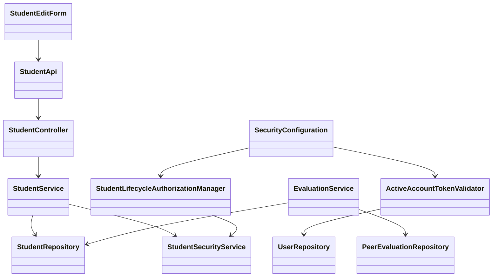
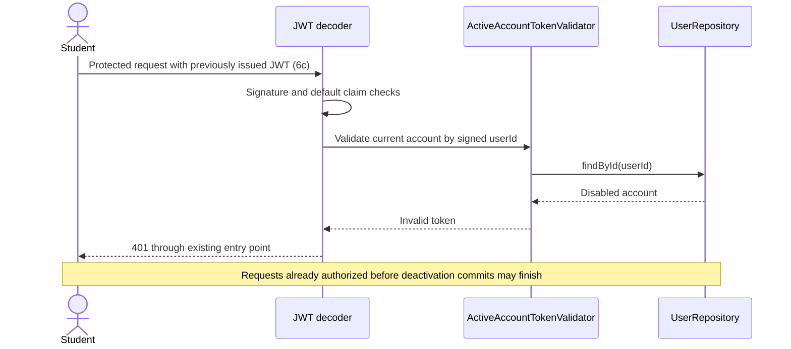

# Student Design

> Realizes: [UC-STU-deactivate-student](../requirements/use-cases.md#uc-stu-deactivate-student-the-course-admininstructor-deactivates-a-student)
> Depends on FRs: [FR-SEC-active-account](../requirements/software-requirements-specification.md#security-and-authorization-requirements), FR-SEC-deny-unauthorized
> See: [Business rules](../requirements/business-rules.md), [business domain model](../requirements/software-requirements-specification.md#business-domain-model), [containers](architectural-design.md#containers), and [crosscutting concepts](architectural-design.md#crosscutting-concepts).

## Overview

Extend the existing student vertical slice and shared authentication machinery. The scope is deactivation and its effects on evaluations, reminders, and retained work. Reactivation receives only the membership constraint in its Associated Information; no new reactivation feature is designed here.

## Components & classes



Reused and extended:

- [EditStudentForm.vue](../../frontend/src/pages/students/EditStudentForm.vue), [Students.vue](../../frontend/src/pages/students/Students.vue), and [student API](../../frontend/src/apis/student/index.ts): dedicated action, warning, request, and list refresh.
- [StudentController](../../backend/src/main/java/team/projectpulse/student/StudentController.java), [StudentService](../../backend/src/main/java/team/projectpulse/student/StudentService.java), [StudentRepository](../../backend/src/main/java/team/projectpulse/student/StudentRepository.java), and [StudentSecurityService](../../backend/src/main/java/team/projectpulse/student/StudentSecurityService.java): scoped, idempotent transition. Identity comes from `UserUtils`. The service's repository query includes the student ID and caller ownership/assignment predicate; it must not load an arbitrary student and compare scope afterward. No scoped result means the uniform 403 refusal.
- [SecurityConfiguration](../../backend/src/main/java/team/projectpulse/security/SecurityConfiguration.java) and [UserRepository](../../backend/src/main/java/team/projectpulse/user/UserRepository.java): compose token checks with a current account lookup by signed `userId`; no token-status cache.
- [EvaluationService](../../backend/src/main/java/team/projectpulse/evaluation/EvaluationService.java), [PeerEvaluationRepository](../../backend/src/main/java/team/projectpulse/evaluation/PeerEvaluationRepository.java), and [SubmitTeamsEvaluations.vue](../../frontend/src/pages/evaluations/SubmitTeamsEvaluations.vue): enforce BR-evaluation-inactive-student. Keep existing evaluations visible for permitted edits; omit inactive targets only when creating new evaluations.
- [SubmissionStatusService](../../backend/src/main/java/team/projectpulse/notification/SubmissionStatusService.java): reuse existing BR-submission-owed eligibility without changing its definition.

New:

- `security/authorizationmanagers/StudentLifecycleAuthorizationManager`: route authorization delegated to a new `StudentSecurityService.canDeactivateStudent` check. Require an instructor/admin authority and either matching course ownership or assignment to the student's course section. Missing/malformed IDs and broken ownership links fail closed.
- `security/ActiveAccountTokenValidator`: validator composed with the decoder's default token validators, including expiry, rather than replacing defaults. A missing account or disabled account produces an invalid-token result through the existing bearer-token entry point. Basic login continues to use `MyUserPrincipal.isEnabled`.

## Sequence

### Deactivate a student

```mermaid
sequenceDiagram
    actor Instructor
    participant Form as EditStudentForm
    participant API as StudentController
    participant Guard as Security / lifecycle guard
    participant Service as StudentService
    participant DB as Repositories
    Instructor->>Form: View details; choose Deactivate (steps 2–3)
    Form->>Instructor: Warning and confirmation (step 4)
    alt Cancel or dismiss (4a)
        Form->>Form: Close warning; no request
    else Confirm (step 5)
        Form->>Guard: POST /students/{studentId}/deactivate
        Guard->>DB: Validate caller account; check student scope (1a)
        Guard->>API: Authorized request
        API->>Service: deactivateStudent(studentId)
        Service->>DB: Scoped query by student ID and caller; lock row
        Service->>DB: Set enabled=false; retain links and work (step 6, 6a)
        Note over Service,DB: Already inactive also succeeds (6d)
        Service-->>API: Student
        API-->>Form: Result with StudentDto
        Form->>Instructor: Success and refreshed status (step 6)
    end
```

### Existing session and downstream effects



Evaluation creation re-resolves the evaluatee through existing converters and checks current `enabled` before save. `POST /evaluations` creates a new record; a duplicate `(week, evaluatorId, evaluateeId)` remains a validation error. Edits use the existing `PUT /evaluations/{evaluationId}` route, resolve that authorized stored record, and retain its submission-window checks without applying the new inactive-target creation check.

The weekly report queries students within the requested course section and includes active students on teams plus inactive students who received an evaluation for the requested week, including retained evaluations if team membership was later removed separately. Use the student's current team name for the existing flat report projection, or its existing absent-team value if unassigned; do not reconstruct an old team from evaluators or create a historical team group. Reuse or batch the existing evaluation queries; never infer dates or membership history. These are the 6b effects; reminder eligibility remains owned by `SubmissionStatusService`.

## API contract

Paths below use the configured `/api/v1` base and existing `Result` envelope.

| Endpoint / behavior | Caller | Request | Success | Errors / extensions |
|---|---|---|---|---|
| **New** `POST /students/{studentId}/deactivate` | Owning course admin or instructor assigned to student's course section | Path ID; no body | HTTP 200, success envelope with StudentDto, `enabled=false`; 6d uses the same response | 1a: HTTP 401 if unauthenticated; HTTP 403 if unauthorized, missing, or inaccessible ID; no mutation |
| **Changed** `PUT /students/{studentId}` | Existing authorized callers | Existing validated StudentDto plus optional `expectedEnabled` query parameter containing status observed when form loaded | Existing profile update; preserve existing inactive-to-active path when `expectedEnabled=false` | HTTP 400 for active-to-inactive transition; HTTP 409 if supplied expected status differs from locked current status, or reactivation omits expected status; no partial profile changes |
| **Changed** bearer authentication on protected requests | Existing token holders | Existing JWT | Existing response for active accounts | 6c: HTTP 401 for disabled/missing account, even when token is unexpired |
| **Changed** `POST /evaluations` | Existing authorized active evaluator | Existing validated evaluation payload | Existing response | 6b: HTTP 400 for an inactive evaluatee; no new evaluation |
| **Reused** `PUT /evaluations/{evaluationId}` | Existing authorized evaluator | Existing validated update payload and stored evaluation identity | Existing update response, including when evaluatee is inactive | Existing ownership and closed-window refusals; never creates a replacement record |
| **Changed** `GET /evaluations/sections/{sectionId}/week/{week}` | Existing scoped instructor access | Existing path parameters | Existing report envelope with inclusion per BR-evaluation-inactive-student | Existing authorization errors |

The warning enumerates loss of access (including existing sessions), no reminders, no new evaluations of the student, retained account/team/work, and weekly-report visibility. Disable submission while pending. Cancel, close, and Escape issue zero requests. On failure show the existing request error and do not claim success; reload status when reopening or retrying after an uncertain response. Hide the action for an already inactive student; server idempotency still covers stale views and repeated requests.

For an active student the profile form shows status read-only and offers the dedicated Deactivate action. For an inactive student it preserves the existing reactivation status control and submits the originally loaded `expectedEnabled=false`; it adds no new reactivation UI. After taking the generic-update row lock, check a supplied expected status first (409 on mismatch), then reject a current active-to-inactive request (400), then require the inactive baseline for reactivation. Reload after 409 rather than silently resubmitting a changed status.

## Key decisions

- **Retain membership and work**, per BR-student-deactivation-membership. Removing the team link was rejected because it would conflate withdrawal with team administration and damage existing report navigation.
- **Use recorded evaluations for weekly report inclusion**, per BR-evaluation-inactive-student. Filtering all inactive students loses historical results; retaining blank inactive rows for every week is misleading. A deactivation timestamp was rejected because the selected rule needs received records, not inferred historical status. Existing edit-window behavior is retained rather than adding a second lock policy.
- **Read current account status for each JWT request**, per FR-SEC-active-account. Waiting two hours for expiry or trusting token claims alone leaves access open. Keep default cryptographic/claim checks; lookup failure must not authenticate a user. This adds one database read per token-authenticated request for students and instructors.
- **Use ownership/assignment rather than a global admin bypass**, per BR-student-lifecycle and BR-section-scoped-access. Authorization runs before idempotency; inactive accounts and unknown identifiers cannot be probed by unauthorized callers. Both the route and service require an instructor/admin authority and enforce the scope, with identity and role checks through `UserUtils`.
- **Keep a dedicated deactivation transition**. A generic profile update cannot turn an active account off; otherwise it bypasses the reviewed interaction. Existing reactivation is preserved, rather than implementing the mirror use case here.
- **Serialize account/profile writes with a row lock** in the existing transactional service. The deactivation finder is caller-scoped and obtains a pessimistic write lock; generic profile updates use the same row-lock discipline before checking status and writing. The frontend submits its originally loaded status as `expectedEnabled` for every profile save. A stale active form therefore receives 409 after deactivation instead of reactivating the account. Legacy profile-only saves without the parameter remain accepted if they do not change account status; intentional reactivation must supply `expectedEnabled=false`. A new version column was rejected because a status precondition and row locking protect this transition without a schema migration. Deactivation changes only `enabled`, so it cannot overwrite a concurrent name, email, or team change.
- **Idempotent repeat, no-request cancellation**, per 6d and 4a. An error for a completed repeat was rejected because safe retries should not misreport an already-achieved state. Cancellation never sends a compensating update.

## Data model and architecture

No new tables, columns, migrations, seed changes, or timestamps. Reuse `PeerEvaluationUser.enabled`, `Student.section`, `Student.team`, activities, and evaluations from the [business domain model](../requirements/software-requirements-specification.md#business-domain-model). The account transition updates only `enabled`.

The new validator and authorization manager stay in the existing shared security/student owners; evaluation changes stay behind `EvaluationService`. No new container, component owner, or deployment change is proposed. Existing login, error envelopes, DTO validation, shared frontend request client, and reminder machinery are reused. No notification email or persistent notification is added.

The architecture's [Authentication](architectural-design.md#authentication) paragraph describes current code as tokens being valid for the full two hours. When the build installs this validator, its documentation must qualify that sentence: there is still no individual-token blocklist or refresh, but a disabled/missing account loses access on its next request. This exact shared authentication documentation correction is surfaced for review with this design; the design PR does not claim the validator is already installed or rewrite current architecture-as-built.

## Tests

Each row is a definition of done; the build PR maps these IDs to actual test methods and execution results. Backend integration tests use real issued tokens and persisted state, not mocked JWT principals, for T6. Cypress tests with API stubs verify browser behavior only and cannot prove server authorization or persistence.

| ID | Use case flow / oracle | Level | Assertions |
|---|---|---|---|
| T1 | Main steps 2–6 | Backend integration; Cypress | Owning admin and assigned instructor can deactivate; dedicated action displays every warning consequence, confirms once, calls correct endpoint, and refreshes inactive status. Active accounts otherwise still work. |
| T2 | 6a; BR-student-deactivation-membership | Backend integration | Student remains in course section and team; account, actual activity rows, and evaluations survive; unrelated students remain active. Include a student without a team. |
| T3 | 6b; BR-evaluation-inactive-student | Unit; backend integration; Cypress | New inactive target omitted in UI and rejected by direct API call; active target accepted; refused evaluation is not persisted. |
| T4 | 6b; BR-evaluation-inactive-student | Unit; backend integration | Inactive student included only in weeks with received evaluations; known scores/comments unchanged; no-record inactive student excluded; active teammate without received evaluations remains; retained history still included after separate team removal. |
| T5 | 6b; BR-evaluation-editable-until-close | Backend integration; Cypress | Existing evaluation remains readable and visible for an active evaluator to edit within its window despite inactive evaluatee; closed-window edits remain refused. |
| T6 | 6c; FR-SEC-active-account | Validator unit; backend integration | Issue real JWT while active, commit deactivation, then reject next protected request with same token; disabled login refused. Active JWT accepted; invalid/expired JWT and missing/malformed account identity refused. Cover disabled instructor too because validator is shared. |
| T7 | 6d | Unit; backend integration | Authorized repeat succeeds with unchanged membership/work; unauthorized repeat remains forbidden. |
| T8 | 1a; BR-student-lifecycle; BR-section-scoped-access | Authorization unit; backend integration | Assigned instructor and owning admin (including owner not assigned to course section) allowed; unassigned instructor, unrelated course admin, student/self, and anonymous caller refused; missing/malformed IDs fail closed; no state changes. Direct service call cannot bypass permission. |
| T9 | 4a | Cypress | Cancel, close, Escape leave state unchanged and make zero deactivation calls; pending confirm prevents double submit; failed request shows no success and permits retry. |
| T10 | Dedicated-action invariant; stale profile save | Unit; backend integration | Generic PUT cannot disable active student or partially save profile on refusal; a form loaded active then saved after deactivation receives 409 without reactivating; ordinary profile updates and explicit existing reactivation with expected inactive status remain functional. Exercise separate committed transactions for the stale save and serialize writes without overwriting other profile fields. |
| T11 | 6a/6b; BR-submission-owed | Reminder/service integration | Deactivated student owes neither item and receives no reminder; active teammate's remaining obligation excludes inactive student; other active targets still count. |

The lifecycle authorization manager resides beside the existing route wrappers in `security/authorizationmanagers/`, reusing their `PathVariables.readId` helper; the domain permission decision remains in `StudentSecurityService`. This implementation placement correction does not change authorization policy.

## Implementation and review order

Commit shared service/query/validator behavior and its targeted tests first as the trunk, and pause for the developer to read it. Keep `SecurityConfiguration` decoder wiring and route rule in a separate security commit. Then commit controller/API and student/evaluation UI leaves with their tests. Run targeted tests per commit and full backend/frontend checks before opening the build PR. Conduct the required mutation check against a retained test and restore production code before committing the result. Leave the build PR open.

## Risks and verification limits

- Docker must be running for Testcontainers integration tests. No implementation or executable verification is claimed by this design.
- The account-status lookup adds database work on every JWT request; no new performance benchmark is claimed. Requests authorized before the deactivation transaction commits may finish.
- Historical rows are governed by the selected record-based rule, not historical enrollment reconstruction. Reactivation cannot recreate separately removed membership.
- A timeout can leave the browser uncertain whether deactivation committed; idempotent retry and refreshed status handle that case without a second state transition.
