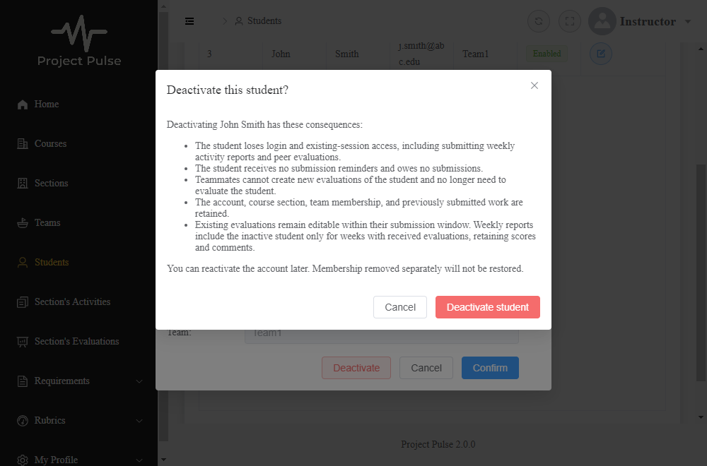

# Student deactivation verification

Agent-generated evidence for UC-STU-deactivate-student and [the design](../design/stu.md). This records code review and executed checks; the student's personal review is still required before submission. Trunk commit `a45dfa9` was published before the leaves, and the user authorized continuation.

## Executed checks

| Check | Result |
|---|---|
| Trunk targeted backend run | 71 tests passed across nine classes; restored evaluation unit suite then passed 18/18 |
| Security commit targeted run | 15 tests passed, including four real-token integration tests |
| Endpoint commit targeted run | 17 tests passed, including four new endpoint tests and 13 existing student API tests |
| Full backend suite | 478 passed, zero failures/errors/skips. This full run preceded the final GET owner-read correction; the following targeted run verifies that correction and existing route/student regressions. |
| Final owner-read security regression | 41 passed, zero failures/errors/skips across StudentDeactivationApiIntegrationTest, StudentIntegrationTest, AuthorizationRuleIntegrationTest, and EvaluationServiceTest |
| New Cypress specs | 11/11 passed: nine student deactivation tests and two inactive-evaluation tests |
| Full Cypress suite | 30 tests: 21 passed, five failed in four legacy specs, four skipped. Four login/menu failures reproduced against unchanged main frontend with the same backend; its reminder spec passed 9/9. A focused reminder rerun on this branch also passed 9/9, so the first-run request-count failure remains recorded as intermittent. |
| Frontend production bundling | `npm run build-only` passed |
| Full frontend build/type check | Failed with the same 18 TypeScript errors as an isolated copy of merged `main`, using identical dependencies; no new errors |
| Documentation/whitespace | No new audit findings: 173 definitions, 98 UCs/98 trace rows, 96 active UCs, 38 business-rule index rows; `git diff --check` passed. The 25 other missing-extension UCs remain tracked in OI-40. |
| Manual live browser flow | Not verified: automatic approval review rejected native Chrome access; fixture browser tests do not establish live browser/backend integration |

The baseline TypeScript errors are in SearchPeriod, SearchWeek, TopNavigationBar, SectionsActivities, StudentActivities, StudentEvaluations, RamDocumentEditor, Teams, and UserRegistration. They are outside this change. Reproduced legacy browser failures concern the login heading/credentials and menu login hooks. The reminder request-count assertion failed once, passed on the baseline frontend, and passed on a focused branch rerun; its nondeterminism was not repaired in this use case. No claim is made that the entire frontend suite is green.

## Design test list

All names below refer to actual assertions, rather than test names alone. Final execution results are recorded above.

| Row | Coverage |
|---|---|
| T1 | `StudentDeactivationApiIntegrationTest.owningAdminAndAssignedInstructorCanDeactivateAndRepeat`; owner-read regression; Cypress warning, confirmation, one request, success, and refreshed inactive row |
| T2 | `StudentLifecycleIntegrationTest.authorizedDeactivationRetainsActualWorkMembershipAndHistory` flushes/clears persistence context and checks real activity counts, evaluation/rating snapshots, course section, team, and unrelated active account; teamless case also covered |
| T3 | `EvaluationServiceTest.testInactiveEvaluateeRefusedWithoutSaving`; service integration checks no persisted evaluation and active creation; direct API refusal; Cypress new target list excludes inactive Eric and retains active John |
| T4 | Unit report test asserts known total/criterion averages plus public/private comments; persisted report includes inactive received history only in its recorded week, including after separate team removal; active blank teammate remains |
| T5 | Service and API integrations read retained evaluations, allow open-window edits, and refuse closed-window edits; Cypress retains inactive target, stored identity, score, and private comment on PUT |
| T6 | `ActiveAccountAuthenticationIntegrationTest` obtains a real login-issued JWT, commits deactivation, and rejects the next protected request with that token; disabled login/instructor, default expiry/signature validation, and malformed/missing account covered |
| T7 | Repeated authorized service/API deactivation succeeds while retaining work; unauthorized inactive repeat refused; UI hides the action for an inactive account |
| T8 | Owner without course-section assignment, assigned instructor, unassigned instructor, unrelated admin, student/self, anonymous, missing/malformed ID, and direct-service refusal covered; final GET regression checks owner form access and unrelated refusal |
| T9 | Cypress Cancel, close, Escape make zero POSTs; pending forced second click makes one POST; refusal displays error and no success before a newly confirmed successful retry; lost response reloads inactive state without success |
| T10 | Generic PUT refuses deactivation before profile mutation; stale observed status gives 409; committed stale save cannot reactivate; row lock preserves concurrent first-name change; explicit inactive baseline still supports existing reactivation; UI forwards baseline and reloads 409 |
| T11 | Existing submission-owed unit/integration tests plus lifecycle integration verify inactive student owes nothing, dispatch excludes her, completed active teammate no longer owes an evaluation of her, and another active student's obligation remains |

## Test oracles kept

One entry per new test method (parameterized identity cases are named together). Existing regression methods changed only to obey the new dedicated-action contract are listed separately below.

- `StudentLifecycleServiceTest.deactivationAndAuthorizedRepeatRetainProfileAndMembership` — UC 6a/6d; BR-student-deactivation-membership; T2/T7.
- `StudentLifecycleServiceTest.unauthorizedDirectCallCannotProbeOrDeactivate` — UC 1a; BR-student-lifecycle; T8.
- `StudentLifecycleServiceTest.inaccessibleOrMissingStudentRefusedBeforeIdempotency` — UC 1a/6d; T7/T8.
- `StudentLifecycleServiceTest.genericUpdateCannotDeactivateOrPartiallyMutateProfile` — dedicated-action invariant and associated stale-save information; T10.
- `StudentLifecycleServiceTest.staleActiveFormCannotReactivateOrPartiallyMutateProfile` — UC Associated Information; T10.
- `StudentLifecycleServiceTest.reactivationRequiresExplicitInactiveBaseline` — design PUT contract; T10.
- `StudentLifecycleServiceTest.legacyProfileOnlySavePreservesInactiveStatus` — design preserves ordinary profile saves; T10.
- `StudentLifecycleIntegrationTest.authorizedDeactivationRetainsActualWorkMembershipAndHistory` — UC step 6, 6a/6b/6d; both deactivation business rules; T1/T2/T4/T7.
- `StudentLifecycleIntegrationTest.inactiveCreationIsNotPersistedAndActiveCreationStillWorks` — BR-evaluation-inactive-student; T3.
- `StudentLifecycleIntegrationTest.inactiveEvaluateeRetainsOpenWindowEditsAndClosedWindowRefusal` — BR-evaluation-inactive-student; BR-evaluation-editable-until-close; T5.
- `StudentLifecycleIntegrationTest.ownerWithoutSectionAssignmentAndAssignedInstructorAllowedButOthersRefused` — UC 1a; BR-student-lifecycle; T8.
- `StudentLifecycleIntegrationTest.teamlessStudentDeactivationAndReminderEligibilityReuseExistingRules` — UC 6a/6b; BR-submission-owed; T2/T11.
- `StudentLifecycleIntegrationTest.committedStaleProfileSaveRefusedAndRowLockSerializesProfileThenDeactivation` — UC Associated Information; design row-lock decision; T10.
- `EvaluationServiceTest.testInactiveEvaluateeRefusedWithoutSaving` — UC 6b; BR-evaluation-inactive-student; T3.
- `EvaluationServiceTest.testReportRetainsInactiveReceivedHistoryAfterTeamRemoval` — UC 6b; BR-evaluation-inactive-student and the specified report averaging algorithm; T4.
- `ActiveAccountTokenValidatorTest.readsCurrentAccountAgainForPreviouslyIssuedToken` — UC 6c; FR-SEC-active-account; T6.
- `ActiveAccountTokenValidatorTest.disabledInstructorAndMissingAccountAreInvalid` — FR-SEC-active-account and design fail-closed identity lookup; T6.
- `ActiveAccountTokenValidatorTest.malformedAccountIdentityFailsClosed` (invalid, fractional, overflow, zero, negative) — design token identity contract; T6.
- `ActiveAccountTokenValidatorTest.missingIdentityFailsClosed` — design token identity contract; T6.
- `ActiveAccountAuthenticationIntegrationTest.issuedStudentTokenLosesAccessAfterCommittedDeactivationAndLoginIsRefused` — UC 6c; FR-SEC-active-account; T6.
- `ActiveAccountAuthenticationIntegrationTest.disabledInstructorAlsoLosesTokenAccessAndCannotLogin` — FR-SEC-active-account; T6.
- `ActiveAccountAuthenticationIntegrationTest.decoderRetainsExpiryAndSignatureChecksAndRejectsMissingMalformedOrUnknownAccount` — design default-validator composition and account lookup; T6.
- `ActiveAccountAuthenticationIntegrationTest.lifecycleRouteRefusesStudentsAnonymousMalformedAndMissingTargets` — UC 1a; FR-SEC-deny-unauthorized; T8.
- `StudentLifecycleAuthorizationManagerTest.delegatesTheBoundStudentId` — design route permission contract; T8.
- `StudentLifecycleAuthorizationManagerTest.deniesWhenTheVariableIsAbsent` — UC 1a; fail-closed route contract; T8.
- `StudentLifecycleAuthorizationManagerTest.deniesWhenTheVariableIsNotANumber` — UC 1a; fail-closed route contract; T8.
- `StudentDeactivationApiIntegrationTest.owningAdminAndAssignedInstructorCanDeactivateAndRepeat` — UC step 6, 6d; BR-student-lifecycle; T1/T7/T8.
- `StudentDeactivationApiIntegrationTest.ownerWithoutAssignmentAllowedAndUnauthorizedInactiveRepeatRefused` — UC steps 2/6, 1a/6d; BR-student-lifecycle; T1/T7/T8.
- `StudentDeactivationApiIntegrationTest.genericPutGuardsStatusBeforeProfileMutationAndAllowsExplicitReactivation` — design PUT contract; UC stale-save information; T10.
- `StudentDeactivationApiIntegrationTest.directInactiveEvaluationCreationRefusedWhileStoredOpenWindowEditSurvives` — BR-evaluation-inactive-student and existing edit window; T3/T5.
- `StudentIntegrationTest.testGenericProfileSaveCannotDeactivateStudent` — dedicated-action invariant; T10.
- `UserUtilsLifecycleTest.anonymousIdentityAndRoleFailClosed` — UC 1a; caller identity convention; T8.
- `UserUtilsLifecycleTest.malformedIdentityFailsClosed` (invalid and overflow) — caller identity convention; fail-closed scope; T8.
- `UserUtilsLifecycleTest.overflowingLongIdentityFailsClosed` — caller identity convention; fail-closed scope; T8.
- Cypress `states all consequences before any request` — UC step 4 and warning Associated Information; T1.
- Cypress `sends no request on Cancel` — UC 4a; T9.
- Cypress `sends no request on close` — UC 4a; T9.
- Cypress `sends no request on Escape` — UC 4a; T9.
- Cypress `confirms once while pending and refreshes inactive status` — UC steps 5/6; pending guard decision; T1/T9.
- Cypress `shows refusal, reloads without success, then completes a confirmed retry` — design failure/retry contract; T9.
- Cypress `reloads status after a lost response without claiming success` — design uncertain-response contract; T9.
- Cypress `hides deactivation for inactive accounts and preserves explicit reactivation baseline` — design UI/PUT contracts; T7/T10.
- Cypress `sends observed status and reloads 409 without reporting a successful save` — UC stale-save information; T10.
- Cypress `offers only active teammates for new evaluations` — BR-evaluation-inactive-student; T3.
- Cypress `retains an inactive target for editing the stored evaluation through PUT` — BR-evaluation-inactive-student; T5.

No tests were deleted. The existing ordinary-profile update fixtures now send the observed active status rather than exercising the former implicit disabling path; the dedicated refusal regression covers that removed behavior. New partial-mutation tests were strengthened to submit different names/username/email, so unchanged-field assertions can detect a premature mutation. Retention assertions compare persisted snapshots by record IDs rather than unspecified query order. The inactive-report oracle now uses explicit fixture arithmetic and public/private comments plus criterion averages, rather than deriving its expected total solely by querying the fixture through a similar computation.

## Mutation check

Temporarily replaced `if (!newPeerEvaluation.getEvaluatee().isEnabled()) {` with `if (false) {` in `EvaluationService.addPeerEvaluation`. Selected the new negative-path test `testInactiveEvaluateeRefusedWithoutSaving` because successful creation tests cannot establish rejection of an inactive target. Running that test produced one failure: "Expecting code to raise a throwable." The production file was restored byte-for-byte with a matching hash, and all 18 evaluation unit tests passed afterward. The broken code is not committed.

## Fresh-context review

- Backend/security/service tests were read against the merged design and specification in a separate fresh context; no material backend findings at that stage.
- **Issue, fixed in `05a64bf`:** owning admin without course-section assignment could POST deactivation but could not GET the student details required to open the form. The GET rule now admits existing readers or the scoped lifecycle guard; a positive owner GET and negative unrelated-admin GET are asserted. PUT and DELETE permissions are unchanged.
- **Suggestion, fixed in `98dea5d`:** the retry test checked reopening but not the displayed error or completed retry. It now asserts the error, no premature success, a second confirmed request, inactive list refresh, and success.
- **Suggestion, fixed in `fc17b05`:** inactive report assertions did not explicitly cover private comments and criterion averages. They now assert known fixture values for both.
- The fresh reviewer reread the frontend and the owner-read/retry fixes and found no remaining material findings. Review was read-only; execution evidence is separate above. This does not assert that the student performed a personal review.

## Confirmation screenshot

This is the actual rendered dialog captured by Cypress with fixture API responses. It is not evidence of a manual live-backend browser run.

